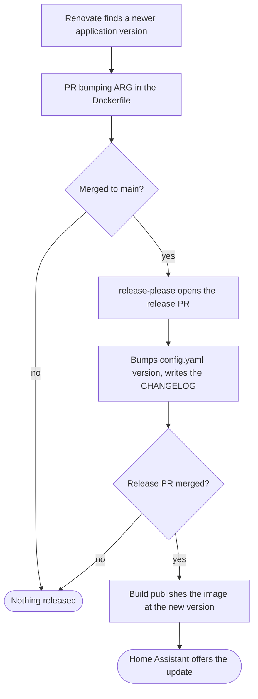

# AGENTS.md

Guidance for coding agents working in this repository.

## What this is

A Home Assistant **app repository**. Home Assistant calls these apps; they were
called add-ons until 2026, and both names still appear in its own tooling. This
repository says "application" in everything it writes, and keeps Home
Assistant's spelling wherever its API surface demands it.

Every top-level directory containing a `config.yaml` is one application. Home
Assistant reads `repository.yaml` to discover the repository, then each
`config.yaml` to discover what it can install.

The authorities, in the order you should trust them:

1. **[Home Assistant Supervisor](https://github.com/home-assistant/supervisor)**
   — the code that actually runs these. When the documentation and the source
   disagree, the source is right.
2. **[home-assistant/apps-example](https://github.com/home-assistant/apps-example)**
   — the reference implementation. Match its shape unless there is a reason not
   to, and record the reason.
3. **[The apps documentation](https://developers.home-assistant.io/docs/apps)**
   — correct in the large, occasionally behind in the details.
4. **`frenck/action-app-linter`** — not an authority, but it is the gate. It
   trails Supervisor, and has rejected values Supervisor documents as current.
   See Traps.

## Commands

There is no `package.json` at the root, so nothing below is a root npm script.
Everything is run from the repository root; the site's own scripts live in
`docs/package.json` and are reached with `npm --prefix docs`.

| Task                  | Command                                                                        | Notes                                                                |
| --------------------- | ------------------------------------------------------------------------------ | -------------------------------------------------------------------- |
| Format                | `npx prettier --write .`                                                       | YAML, JSON, Markdown, and the site's TypeScript and CSS              |
| Check formatting      | `npx prettier --check .`                                                       | `Check formatting` runs this at a pinned version                     |
| Verify release wiring | `./.github/scripts/verify-release-wiring.sh`                                   | Runs in CI as `Verify release wiring`                                |
| Verify applications   | `node .github/scripts/verify-applications.mjs`                                 | After `npm --prefix docs ci`; runs in CI as `Verify applications`    |
| Check shell scripts   | `shellcheck --shell=bash --severity=warning --exclude=SC2154,SC2155 <script>…` | Runs in CI as `Check shell scripts`, at the version `lint.yaml` pins |
| Build the site        | `./.github/scripts/build-pages.sh`                                             | Assembles `_site/`; nothing is committed                             |
| Develop the site      | `npm --prefix docs run dev`                                                    | See `docs/README.md`                                                 |

Building and booting an application image is the other thing worth running by
hand, and it has its own step under Adding an application.

## Conventions

Shared with the other `kanso-labs` repositories. The canonical text is
[`CONVENTIONS.md`](https://github.com/kanso-labs/.github/blob/main/CONVENTIONS.md)
in `kanso-labs/.github`; this is a copy, kept in step by hand. Change that file
first, then every copy.

- **Keys in JSON and YAML are ordered by name.** Files whose order carries
  meaning are exempt: workflows, where step order is execution order;
  changelogs, which are chronological; and `package.json`, where the npm
  ecosystem expects `name` and `version` first.
- **A workflow's filename is the kebab-case of its `name:` field.** Reusable
  workflows, meaning those triggered only by `workflow_call`, take a leading
  underscore.
- **Job names and step names are imperative verb phrases.** Job ids, step ids,
  and matrix keys are exempt.
- **Actions are pinned to exact release tags**, `actions/checkout@v7.0.1`, never
  `@main` and never a tag the publisher moves — `@v7` and `@v7.0` both move.
  Renovate opens the bump pull requests, and it has nothing to open when the pin
  never changes: `frenck/action-app-linter@v2.21` sat still through a repository
  rename and a release that fixed something a consumer was working around,
  because the tag it named was moved onto both.
- **Dependency versions are pinned exactly.** Every `dependencies`,
  `devDependencies`, and `optionalDependencies` entry is a bare version,
  `1.2.3`, never `^1.2.3`, `~1.2.3`, `>=1.2.3`, `*`, `1.x`, or an `||` union.
  Renovate opens those bumps too. `peerDependencies` are the deliberate
  exception: they state what the consumer's own installed copy must satisfy, so
  ranges are correct there and stay.
- **`.tool-versions` pins a fully-specified version on every line**,
  `nodejs <major>.<minor>.<patch>`, never `nodejs 24` or `nodejs lts`.

Two directories here carry a `package.json`, a `package-lock.json` and a
`.tool-versions`: `n8n/rootfs/usr/src/n8n/` and `docs/`. In both, the three
files together decide what gets installed, so the pins are about
reproducibility.

In `n8n/rootfs/usr/src/n8n/` that is what an image ships. The Dockerfile runs
`mise install` and then `npm ci` at build time, so `.tool-versions` decides
which Node and npm do the install, and the lockfile decides every package they
install. `package.json` pins n8n alone, while n8n names much of what it depends
on by range, so without the lockfile an image built today and the same image
rebuilt next month could ship different code off an unchanged commit. `npm ci`
fails outright when the lockfile and `package.json` disagree, and Renovate
refreshes the lockfile with every n8n bump, so the two move together.

In `docs/` they are what makes CI and a laptop build the site on the same Node
and the same packages, and the workflow reads that same `.tool-versions` through
`actions/setup-node`.

**Two actions run from `@master`, against the pinning rule, because there is no
release to pin.** `home-assistant/actions/helpers/find-addons` finds the
applications in `lint.yaml` and `build.yaml`, and `helpers/info` reads each
one's metadata in `_build-application.yaml`. The repository's only tag, `1.0.0`,
dates from 2020 and predates `helpers/` entirely, and a commit SHA is not a
release tag either. Upstream has been asked to tag releases in
[home-assistant/actions#144](https://github.com/home-assistant/actions/issues/144).
Until it does, whatever lands on its `master` runs here on the next job, and
Renovate has nothing to propose. What it can reach is kept small: every job that
runs one holds `contents: read` and nothing else. `_build-application.yaml` has
to say so on its Prepare job, which would otherwise inherit the package and OIDC
scopes the build is given, and its checkout there leaves no token behind.
[#482](https://github.com/kanso-labs/home-assistant-applications/issues/482)
tracks pinning all three once a tag exists, and removing this paragraph.

**Prettier formats the YAML, JSON and Markdown here**, and the site's TypeScript
and CSS along with them; CI checks it. There is no root `package.json`, so there
is no root `format` script — run `npx prettier --write .` before pushing.
`actions` formats the same three with Prettier and does have that script; see
that repository's `AGENTS.md` for what the rest of the organization does.

### Workflow naming

The shared rule is the Conventions bullet above; what it looks like here:

| `name:`              | Trigger                                                 | Filename                  |
| -------------------- | ------------------------------------------------------- | ------------------------- |
| `Build`              | `push`, `pull_request`, `schedule`, `workflow_dispatch` | `build.yaml`              |
| `Build application`  | `workflow_call`                                         | `_build-application.yaml` |
| `Deploy Pages`       | `push`, `workflow_dispatch`                             | `deploy-pages.yaml`       |
| `Lint`               | `push`, `pull_request`, `schedule`                      | `lint.yaml`               |
| `Release Please`     | `push`, `schedule`, `workflow_dispatch`                 | `release-please.yaml`     |
| `Renovate Command`   | `issue_comment`                                         | `renovate-command.yaml`   |
| `Upstream Changelog` | `pull_request`                                          | `upstream-changelog.yaml` |

The leading underscore on a reusable workflow is what separates entry points
from building blocks in the folder listing.

A job name takes any matrix values appended to it, which the shared bullet does
not say. **`build.yaml` matches its own filename in a regular expression**, so
renaming either build workflow means updating that pattern too. The badges in
`README.md` link `build.yaml` and `lint.yaml`, and `docs/README.md` names
`deploy-pages.yaml`, so renaming one of those means editing them as well.

**Lint's checks are steps of two jobs, beside the linter's own.** A free
organization runs 20 jobs at a time across every workflow, and a check in a job
of its own spent minutes waiting for a runner to do seconds of work. A new check
goes into the job it fits as a step with `if: ${{ !cancelled() }}`, so that it
runs and reports whatever failed before it. `Confirm lint succeeded` is the name
branch protection requires, and it needs every job.

### Image naming

An application's `image` is the generic multi-architecture name with no
placeholder. The per-architecture images published underneath it are named
`{arch}-<image>`, architecture first — that order is fixed by the build action
and is not ours to choose.

**An application whose software may not be redistributed names no `image`.**
Each Home Assistant then builds it from the Dockerfile itself, and
`_build-application.yaml` builds it on every change without ever publishing it.
Tdarr and Seadexerr are the two. Tdarr is free for personal use under a licence
that forbids redistributing it, and Seadexerr carries no licence at all, so
nobody has been given the right to pass it on. Tdarr's Dockerfile starts from
the image Tdarr publishes, and Seadexerr's takes the binary from the image its
author publishes, both at build time on the user's machine.

## Adding an application

### 1. Start from existing packaging

Someone has usually packaged it already, most often under
[hassio-addons](https://github.com/orgs/hassio-addons/repositories) as
`app-<name>` or `addon-<name>`. Port that rather than inventing one: the service
scripts, icon, and logo are all reusable, and it is MIT licensed.

Credit the original in the application's `DOCS.md`, and credit the upstream
project separately — the packaging and the software it packages have different
authors and usually different licences.

Do not copy the pinned version. Check what the project has actually released;
the community packaging is often behind, which is usually why an application is
being added here at all.

### 2. Create the directory

Match what the existing applications have:

```
<slug>/
├── CHANGELOG.md      Keep a Changelog format
├── DOCS.md           the full documentation, in the sections below
├── Dockerfile
├── README.md         short intro, shown in the store
├── config.yaml
├── icon.png          square, 128×128
├── logo.png          landscape, 250×100
├── rootfs/           s6 service definition
└── translations/     en.yaml, pt-BR.yaml
```

`README.md` and `DOCS.md` are different documents. The store shows the README as
the intro and DOCS as the full documentation, on the application's
**Documentation** tab. Neither renders a relative link to another file, so the
README says "See the **Documentation** tab", and a link to another application
is an absolute GitHub URL.

`DOCS.md` runs Installation, Configuration, Ingress, Ports, any sections of the
application's own, Storage, Backups, Updates, Support, Credits, then any "A note
on…" sections, leaving out those that do not apply. That is the order a new
application's DOCS follow. Most existing ones depart from it where their reader
needs a section earlier or later than it puts one: a section to read before
installing goes ahead of Installation, as Immich's "Before you install" does, a
first login comes straight after Installation, as NZBGet's does, and a check or
a caveat can follow Storage. They are left as they are rather than moved to fit.
Storage is a table of `| Path | Access | Holds |`, so that what an application
can write is stated rather than inferred. Credits say where the icon and logo
came from.

**Show in sidebar** is off after an install, so an installation step never says
to open the application from the sidebar. Write "Start it, then select **Open
Web UI**, or open port N", as Cleanuparr does.

### 3. `config.yaml`

Keys are ordered by name. Required: `name`, `version`, `slug`, `description`,
`arch`.

Two kinds of key keep the order they are shown in rather than order by name.
Inside `schema`, the Configuration tab shows the options, and the fields of a
list entry, in the order `schema` declares them: order those the way a person
fills them in, and say so in a comment. Inside `ports`, the Network tab lists
the ports in the order `config.yaml` declares them, so they run in port order,
as Nginx Proxy Manager's 80, 81 and 443 do, and `ports_description` and the
translations' `network` follow the same order. `Verify applications` checks the
order of every other key.

```yaml
arch:
  - aarch64
  - amd64
backup: cold
image: 'ghcr.io/kanso-labs/home-assistant-application-<slug>'
init: false
version: '0.1.0' # x-release-please-version
```

- **`image`** is the generic multi-architecture name, with no `{arch}`
  placeholder. See "Image naming" above.
- **`init: false`** because the base image supplies s6-overlay.
- **`backup: cold`** for anything storing state in SQLite, which is most of
  them. A hot backup copies the database while it is being written and can
  restore into a corrupt file.
- **`version`** starts at `0.1.0` and is never edited by hand afterwards. The
  annotation is load-bearing; see Releases.

An application stays below 1.0.0 until it has run on a real Home Assistant, and
its `DOCS.md` says what it still has to prove, in a bold paragraph under the
introduction, as Wallos's does. It reaches 1.0.0 through a pull request titled
`feat(<slug>): release 1.0.0` that removes that paragraph, with this in its
body:

```text
BEGIN_COMMIT_OVERRIDE
feat(<slug>): release 1.0.0

Release-As: 1.0.0
END_COMMIT_OVERRIDE
```

The override has to be in the body, because the squash merge keeps no commit
body for a `Release-As` footer to ride in, and release-please reads the merged
pull request's body. Seadexerr and Immich Power Tools went that way. A
`release-as` entry in `release-please-config.json` does the same but pins every
later release too until it is removed, as Traefik's had to be.

An application that runs its own database, as Authentik, Flight Finder, Grimmory
and Immich do, also sets `timeout: 120`. Supervisor's default gives the whole
container 10 seconds to stop, which can kill the database before it has written
its shutdown checkpoint, during a cold backup as much as an update. A database
killed partway loses nothing, but its next start replays the log first. Traps
has the rest of what an embedded database needs.

Leave `watchdog` out. Supervisor still accepts the key, but the linter fails any
`config.yaml` that sets it, so a health check is a `HEALTHCHECK` in the
Dockerfile instead; see step 4.

Map the least you can. Grant write access only where the application actually
writes, and omit a mapping entirely when it is never touched. Radarr and Sonarr
need `/media` and `/share` because organising files is their job. Prowlarr
manages indexer definitions and gets neither, even though its upstream packaging
maps both.

Publish the least, too. A port only other applications use is declared as
`null`, which leaves it closed until someone opens it under Network, as Byparr's
and FlareSolverr's are. Applications on the same Home Assistant reach it either
way, at `http://2dd33fbd-<slug>:<port>`. `2dd33fbd` is the hash Supervisor takes
of the repository URL as it was added, ignoring case, so it holds on every
install that added the address in the README, while one added with a trailing
slash or `.git` gets another prefix, shown as **Hostname** on the application's
**Info** tab. DOCS that give such an address say so, as Byparr's does. The bare
slug resolves to nothing. Such a port gets no `webui`, because Supervisor builds
that link from the published port.

Ask for `hassio_api` only when the application calls a Supervisor endpoint
beyond its own options and info, which every application can read without it,
and say in a comment which one. Nginx Proxy Manager reads `/dns/info` for its
resolver, and Flight Finder reads this machine's addresses from `/network/info`.

### 4. `Dockerfile`

```dockerfile
# https://developers.home-assistant.io/docs/apps/configuration#app-dockerfile
ARG BUILD_FROM=ghcr.io/home-assistant/base:3.24
FROM ${BUILD_FROM}

ARG BUILD_ARCH=amd64
ARG BUILD_VERSION=dev
# renovate: datasource=github-releases depName=<Org>/<Repo>
ARG <APP>_VERSION=1.2.3
```

- **`BUILD_FROM` must carry a default.** Supervisor stopped supplying it in
  2026.04, so `FROM $BUILD_FROM` with no default expands to `FROM ` and fails.
- **There is no `build.yaml`.** It is deprecated. The base image and the OCI
  labels live in the Dockerfile.
- **`BUILD_ARCH` and `BUILD_VERSION` are injected** by the build action, along
  with the `io.hass.*` labels. Do not duplicate those labels.
- The `# renovate:` annotation is load-bearing, on the line directly above its
  `ARG`, and `Verify release wiring` fails without it; see Releases.

`ghcr.io/home-assistant/base` is Alpine and supplies s6-overlay, bashio, curl,
and jq. `base-python` is the same with Python on it, and `base-ubuntu` and
`base-debian` are the Debian-family equivalents. All of them are multi-arch, so
one tag covers every architecture.

Name the base by its release, as `base:3.24`, `base-ubuntu:26.04` and
`base-debian:trixie` are. Renovate adds the digest of the image that tag names,
and opens a pull request each time Home Assistant rebuilds it under the same
tag. That pull request automerges and is typed `deps`, so each rebuild releases
a patch of every application on the base, which is how its security fixes reach
installs: an application publishes a version only once, so a rebuild behind an
unchanged pin would never ship. `base-debian`'s dated tags, such as
`trixie-2026.08.0`, are not versions Renovate's docker versioning can read, so a
pin to one never moved; `trixie` is not one either, so moving Nginx Proxy
Manager to Debian's next release is done by hand, along with the suite its Nginx
annotation names. `base-python`'s tags name a Python release and an Alpine one,
as in `3.14-alpine3.24`, and `.github/renovate.json` gives it a versioning that
follows both.

**Pin a package only through an annotated `ARG`**, so that Renovate moves it and
each new version cuts a release: the application itself where a distribution
packages it, as Alpine does Avahi, iptables and qBittorrent, and a server it
leans on, as Nginx Proxy Manager pins Nginx and Node.js and Immich pins
PostgreSQL. Leave the distribution's other packages to the base tag, which
already fixes the release they come from.

- **Debian's own archive keeps only the current version of each package**, so an
  exact pin to it stops resolving at the next point release and fails every
  build until someone edits it. Pin a Debian package only from a third-party
  repository, with `# renovate: datasource=deb depName=… registryUrl=…`, as
  Nginx Proxy Manager does from nginx.org and NodeSource, which keep every
  version, and Immich from apt.postgresql.org.
- **An Alpine pin's annotation names its index branch**, as in `branch=v3.24`,
  and that branch moves by hand when the base takes a new Alpine release, since
  the build fails until it does. Avahi Publisher, NAT Gateway and qBittorrent
  carry such pins, so their base-image bumps come in a group of their own,
  `Home Assistant Base Images with Alpine package pins`, and the failure holds
  back only them. An application added on a Home Assistant base with a pin like
  theirs joins that group in `.github/renovate.json`. Flight Finder and Grimmory
  pin Alpine packages too, on upstream's image rather than Home Assistant's, so
  their branch follows upstream's Alpine, and the build that fails is the bump
  of the application itself.

**A health check is a `HEALTHCHECK`.** With an application's Watchdog toggle on,
Supervisor restarts it when Docker reports it unhealthy, which is the only way
it notices a hang rather than an exit. Probe the application's own health or
status endpoint with `curl -f` on `127.0.0.1` and the port it listens on, which
works whatever the host maps that port to, and give `--start-period` room for a
first start's migrations. Authentik's Dockerfile explains why a `HEALTHCHECK`
inherited from upstream is replaced rather than set to `NONE`. One inherited and
kept gets a comment naming what it probes, and an application with nothing to
probe says so in a comment, so that a missing check reads as decided rather than
forgotten. `Verify applications` fails a Dockerfile with neither.

Watchdog is off by default, so a check restarts nothing until someone turns it
on. Every application with one says so at the end of its `DOCS.md`'s
Configuration section, as Cleanuparr's does: "Turn on **Watchdog** on the
application's Info tab to have Home Assistant restart Cleanuparr when it stops
answering, not only when it exits", then what the check asks, then "It is off by
default."

**Run as upstream's user when its image defines one**, dropping to it with
`s6-setuidgid` and handing it the directories it writes. Supervisor never remaps
a user, so whatever the run script execs as is what runs. Root is right on a
Home Assistant base image, whose software has no user of its own, and for an
application that writes under `/media` or `/share`, which Supervisor mounts
owned by root.

**An image that installs s6-overlay by hand, or takes it from upstream's, sets
`ENV S6_BEHAVIOUR_IF_STAGE2_FAILS=2` once it has an init script.** Home
Assistant's base images set it, so that a failing options script stops the
container. At s6's default the application starts anyway with its options half
applied. Tdarr and Plex set it for that reason.

### 5. `rootfs/`

Copy the upstream service definition. The layout Supervisor expects:

```
rootfs/etc/s6-overlay/s6-rc.d/<slug>/run          executable
rootfs/etc/s6-overlay/s6-rc.d/<slug>/finish       executable
rootfs/etc/s6-overlay/s6-rc.d/<slug>/type         contains "longrun"
rootfs/etc/s6-overlay/s6-rc.d/<slug>/dependencies.d/base    empty
rootfs/etc/s6-overlay/user-bundles.d/user/contents.d/<slug>  empty
```

`run` and `finish` need the executable bit. The empty marker files must exist
and stay empty. The user bundle goes in `user-bundles.d`, where s6-overlay
3.2.3.2 reads it. Its older location, `s6-rc.d/user`, still works but logs a
deprecation warning at every start, and its mere presence makes s6-overlay
ignore `user-bundles.d`, so an application never has both. `Verify applications`
fails one that has `s6-rc.d/user`.

### 6. Register it

- Add a row to the applications table in the repository `README.md`, in
  alphabetical order. One line on what it does, and the port it serves its web
  interface on, or `Ingress`, or `Ingress, port N` when it serves both, or
  `None`.
- Add the package to `release-please-config.json` and
  `.release-please-manifest.json`, both alphabetically.
- Add the `depName` of the application's own version to the curated `fix` rule
  in `.github/renovate.json`, alphabetically. Without it an upstream release is
  typed `deps` like any other bump: it ships as a patch under **Dependencies**
  whatever step upstream took, without upstream's notes, and a 0.x minor
  automerges. `Verify applications` fails an application none of whose versions
  is on it.
- The website needs nothing. It is generated from every `config.yaml` and
  `icon.png` at deploy time, so the directory existing is enough — see The
  website.

### 7. Verify before pushing

Every one of these has caught a real failure. Run them.

**Validate against the linter's own schema**, rather than waiting for CI to tell
you:

```shell
gh api -H 'Accept: application/vnd.github.raw' \
  'repos/frenck/action-app-linter/contents/src/config.schema.json?ref=v2.21.1' \
  > /tmp/app.schema.json
```

The ref is the linter tag `lint.yaml` runs, and moves with it.

Then check your `config.yaml`'s map types and top-level keys against it. This
exists because the linter rejects values Supervisor documents as current. The
schema is not the whole linter, though: it accepts `watchdog`, which the linter
fails; see Traps.

**Build and boot it.** A green build proves nothing about whether the thing
starts:

```shell
docker build --platform linux/arm64 --build-arg BUILD_ARCH=aarch64 \
  --build-arg BUILD_VERSION=1.0.0 -t <slug>-test .
```

Run it with `/config` and `/data` mounted, then check the logs for the version
and a listening port, and probe the port for a response. Build for the
architecture you are actually on — see Traps.

bashio reads the options from Supervisor at `http://supervisor`, so outside Home
Assistant the container needs a stand-in there: a small HTTP server on the
host's port 80 answering `GET /addons/self/options/config` and
`/addons/self/info` with `{"result": "ok", "data": {…}}`, reached with
`--add-host supervisor:host-gateway` and any `SUPERVISOR_TOKEN`. Recreate the
container to test a change of options, as Supervisor does on every start. bashio
caches what it reads under `/tmp/.bashio`, which survives `docker restart`, so a
restarted container goes on with the options it first started with.

**Run `npx prettier --check .`** from the repository root. Prettier formats
YAML, JSON and Markdown here, plus the site's TypeScript and CSS, and
`Check formatting` runs the same check at the version `lint.yaml` pins in
`PRETTIER_VERSION` — match it if the two ever disagree. There is no root
`package.json`, so there is no root `format` script.

Changelogs are exempt, in `.prettierignore`. release-please writes them in a
style of its own and reads them back to place the next entry, so formatting one
lasts until the next release and risks confusing the tool that owns it.

**Verify the release wiring**, which catches a registration you forgot in step
6, either annotation dropped or misshapen, and a `version` that no longer
matches the manifest:

```shell
./.github/scripts/verify-release-wiring.sh
```

CI runs this too, as `Verify release wiring`. It does not read the curated rule
in `.github/renovate.json`.

**Verify the conventions**, which catches what steps 2 to 6 ask for and no other
check reads: key order, translations that cover every option, list field and
port in both languages, the executable bit on every script under `rootfs/`, the
user bundle in `user-bundles.d` rather than `s6-rc.d/user`, the icon and logo
sizes, the curated rule, a health check or a comment saying why there is none,
and the retry flags on every download:

```shell
npm --prefix docs ci && node .github/scripts/verify-applications.mjs
```

**Check the scripts** with shellcheck, as `Check shell scripts` does in CI, at
the version `lint.yaml` pins. The command is in the table under Commands.

## Releases

Home Assistant decides an update exists by comparing `config.yaml`'s `version`
against the installed one — a plain inequality, so the string only has to move.
If it never moves, nothing you change inside an image ever reaches anyone.

Nobody edits that field by hand. release-please owns it.

How it runs is shared with the other `kanso-labs` repositories rather than
configured here: [`kanso-labs/actions`](https://github.com/kanso-labs/actions)
holds the workflow, and `.github/workflows/release-please.yaml` calls it at a
pinned tag. Changing the token, the auto-merge behaviour, or the release-please
version means changing it there and bumping the pin here, which Renovate opens a
pull request for.



**A version is published once.** Build publishes an application only while
`<image>:<version>` does not exist yet. Once it does, a push to main still
builds the application, as a check, but pushes nothing and leaves `latest` where
it is, so an unreleased change never reaches a fresh install, a reinstall or a
restore under a version already released. Every push used to publish, and that
is how the bump to Cleanuparr 2.10.11 reached installs as the application's
1.3.0 before release-please had cut anything. The multi-arch tag is written only
once every architecture's image is pushed, so a release whose build failed
partway publishes in full on Build's next hourly run, which publishes every
released version missing from the registry. **Run workflow** on Build does the
same at once. A broken release is repaired by releasing a new version, never by
pushing over it.

Build builds an application for any change in its directory, deletions included,
except the files no image carries: `CHANGELOG.md`, `DOCS.md`, `README.md`,
`icon.png`, `logo.png` and `translations/`. Naming what to skip rather than what
to build is what covers Nginx Proxy Manager's `patches/`, which reach its image
through a `COPY` outside `rootfs/` and used to build nothing when they alone
changed.

Each application is its own release-please package. A commit is attributed to
one by the files it touches, so a change under `radarr/` releases Radarr alone.

**Which commit types release.** A breaking change, marked `!` as in `feat!`,
takes a major; `feat` takes a minor; `fix`, `deps`, `perf` and `revert` take a
patch; everything else releases nothing. `release-please-config.json` spells the
list out in `changelog-sections`, so removing `feat` or `fix` from it would
silently stop those releases too — for the reason the paragraph below gives.

**Renovate commits are typed `deps:`, and that is what makes them release.**
release-please computes a patch bump for any commit that is not a `feat` or a
breaking change, but it only opens a release pull request when the notes it
generates are non-empty — a run whose every commit falls in a hidden changelog
section is skipped as "No user facing commits found". Renovate's default,
`chore(deps):`, lands in exactly such a section, so an upgrade never cut a
release of its own: it shipped only when a feature happened to land beside it,
and a run of nothing but upgrades published nothing at all.

The organization's shared preset therefore sets `semanticCommits: enabled` and
`semanticCommitScope: null` at the top level, and `semanticCommitType: deps` in
a catch-all `packageRule` rather than beside them. That is
`local>kanso-labs/.github:renovate-config`, which `.github/renovate.json`
extends after `config:recommended` so that it wins, and none of the three is
restated here: a copy would only drift from what every other `kanso-labs`
repository gets. `release-please-config.json` spells out `changelog-sections`
with `deps` visible under a `Dependencies` heading. The two move together: that
list replaces release-please's defaults wholesale, so a type missing from it is
invisible rather than merely unstyled, and `deps` with no matching section would
put the upgrades back where they started.

**This widened what releases, and that is the intended effect.** A bump inside
an application directory that is not one of the curated `depNames` below — a
Home Assistant base image, most obviously — used to be `chore(deps)` and
released nothing, so it reached users silently, folded into whatever `fix`
happened to land next. It now reads `deps` and cuts a patch of its own.

A bump outside every application directory still releases nothing, because there
is no root package for it to be attributed to. That is what keeps a Prettier or
`actions/checkout` bump from versioning every application.

**Every `semanticCommitType` setting is a `packageRule`, and none can be a
top-level key.** `config:recommended` extends
`:semanticPrefixFixDepsChoreOthers`, which sets the type through `packageRules`
of its own, and `packageRules` beat top-level config. The catch-all `deps` rule
is therefore the preset's first, and every rule in `.github/renovate.json` comes
after the preset's, so the curated rules below still override it for the
applications they name.

**An application's version takes the same step upstream's did.** A patch of
Sonarr is a patch of the Sonarr application, a minor is a minor, and a major is
a major. Three rules in `.github/renovate.json` do it, in this order:

1. The curated rule lists the application versions and types them `fix`.
2. A rule retypes a `fix` whose update is a minor as `feat`.
3. A rule retypes a `fix` whose update is a major as `feat!`.

The second and third find the applications by the type the first gave them,
through `matchJsonata`, rather than restating its list. That works because
Renovate checks each rule against the config every earlier rule has already
applied — so the curated rule has to stay above them, and its list is the only
one to keep.

The changelog files each release by its type. A patch lands under **Bug Fixes**
and a minor under **Features**; a major lands under **Features** too, and is
listed again under **⚠ BREAKING CHANGES**. None of them moves to
**Dependencies**. Deleting the curated rule would not stop them releasing — it
would re-file them and shrink every bump to a patch.

What decides minor from major is Renovate's versioning for the dependency, not
upstream's own description of the release. For most of these the two agree — a
Sonarr build number or an Alpine package revision moves only the patch — with
two exceptions worth knowing: nzbget has no patch, so each of its releases is at
least a minor, and authentik's version is a date, so its first release of a new
year is a major.

Majors never automerge — the shared preset automerges minors and patches only —
so a major waits for a person to read upstream's notes before it ships.

Neither does a minor of an upstream still below 1.0, which is where a project on
0.x makes its breaking changes. Flight Finder 0.16.0 replaced its sign-in and
was merged and released with nobody having read its notes, so a rule in
`.github/renovate.json` now holds such minors back, matching
`matchCurrentVersion: /^v?0\./`. It finds the applications by the `feat` the
minor rule gave them, so it stays below that rule, and their patches still
automerge.

Nor does a feature release of Authentik. Authentik numbers its releases by date,
so Renovate reads one such as 2026.8 to 2026.11 as a minor, although upstream
treats each feature release as a major and opens its notes with breaking
changes, and its bumps arrive here without those notes. A rule in
`.github/renovate.json` holds those minors back by name, below the 0.x rule.
Authentik's patches still automerge while no feature release is waiting, since
Renovate folds them into the minor while one is.

**Authentik ships one feature release at a time.** It migrates a database last
run by its own feature release or the one before, and refuses anything older
with `Major version skips are not allowed`. Home Assistant installs only the
newest version of an application, so a feature release this repository skips
leaves every install still on the one before with no update that starts.
Renovate keeps one pull request for the newest minor and one for the newest
major, and moves each to the newest release as another ships, so a feature
release left waiting past the next one, or the major that opens a new year left
waiting past that year's second feature release, skips one. Before merging,
check that the pull request moves exactly one feature release. If it moves two,
leave it unmerged and bump to the release in between by hand first, typed as
Renovate would have typed it. Renovate then rebases its pull request onto that,
and it moves one.

An application below 1.0.0 goes to 1.0.0 the first time upstream takes a major,
because release-please's default treats a breaking change the same at any
version.

**There is one release pull request, not one per application.** Each application
still gets its own version, tag and changelog inside it; what is shared is the
pull request carrying them. `separate-pull-requests` was `true` until several
applications first became releasable at once, and the reason it cannot go back
is in Traps.

Its title reads `chore: release main`, which names the branch every release
already targets and so says nothing. Leave it alone anyway; the reason is in
Traps.

**Two annotations hold this together, and removing either fails silently.**

- `# x-release-please-version` beside `version` in `config.yaml` tells
  release-please which line to rewrite.
- `# renovate: datasource=… depName=…` above the `ARG` in the Dockerfile tells
  Renovate what to watch.

Neither produces an error of its own when missing. The application simply stops
receiving updates, and nobody notices until someone checks.

`.github/scripts/verify-release-wiring.sh` is that check, and runs in CI as
`Verify release wiring`. It fails when `config.yaml` lacks the first annotation,
and when an `ARG <NAME>_VERSION=` pin other than `BUILD_VERSION` is not directly
below the second in one of the two shapes the Dockerfile managers read:
`datasource=… depName=…`, with an optional `registryUrl=…` after them. A
`custom.` datasource has to be one `.github/renovate.json` defines under
`customDatasources`, since Renovate skips a dependency whose datasource it
cannot find. The script also checks the release-please registrations in step 6,
and that `config.yaml`'s `version` equals the manifest's: release-please
computes the next release from the manifest alone and writes it over
`config.yaml`, so a difference means one of them was edited by hand.

A version written anywhere but such an `ARG` is outside what the script sees,
and outside what Renovate sees too, unless a manager reads it natively, as the
Dockerfile manager reads `BUILD_FROM`. Nginx Proxy Manager pinned Nginx inline
in its install line, and stayed on 1.31.6 past the five CVE fixes in 1.31.7.

**UnRAR's version is not the number in its tarball's name.** RARLAB publishes no
feed and no repository, so `.github/renovate.json` defines a `rarlab` datasource
that reads its download page, `rar_add.htm`, and takes Bazarr's `UNRAR_VERSION`
out of the source tarball's name. Those are numbered by build within a series
rather than by version: `unrarsrc-7.2.7` is UnRAR 7.23, and `unrarsrc-7.3.1` is
7.30 beta 1. The page links only the newest, betas included, and `RARVER_BETA`
in the tarball's `unrar/version.hpp` is the only way to tell one from a release.
Renovate cannot tell either, so `.github/renovate.json` never automerges an
UnRAR bump, and Bazarr's Dockerfile reads `RARVER_BETA` after unpacking and
fails the build on a beta, which keeps one from passing
`Confirm builds succeeded`. Bazarr 1.2.0 shipped 7.30 beta 1 before the build
checked. `.github/renovate.json` also excludes 7.3.1 with `allowedVersions`, so
that the beta Bazarr went back from is not proposed again, and the exclusion
comes out once RARLAB links a later tarball.

### Upstream release notes in the changelog

What a user sees when Sonarr's version moves is Sonarr's release notes, not
ours. `.github/workflows/upstream-changelog.yaml` is what gets them there: it
calls a shared composite action which rewrites the Renovate pull request body so
that release-please reads the upstream notes out of it at merge time, and files
them under an **Upstream changes** heading beside the bump's own line.

The body is where this has to happen, and that is not a design preference.
Squash merging here uses `squash_merge_commit_message: BLANK`, so a branch's
commit bodies never reach `main` — but release-please reads the _pull request_
body of the commit it is parsing, and honours a `BEGIN_COMMIT_OVERRIDE` block in
it. Renovate's own `fetchChangeLogs: branch` and `commitBody` write a commit
body that nothing here would ever read.

**Three things have to agree, and two of them are in this repository.**

- `release-please-config.json` carries an `upstream` entry in
  `changelog-sections`. Without it the lines are parsed and then hidden, which
  looks exactly like the action not running.
- The workflow triggers on `edited` as well as `opened` and `synchronize`,
  because a Renovate rewrite of the body replaces what the action wrote.
- The action itself lives in
  [`kanso-labs/actions`](https://github.com/kanso-labs/actions/tree/main/actions/upstream-changelog),
  pinned by tag. Its README holds the mechanism and the traps.

**It runs for the applications, not for every upgrade**, and the filter is the
commit type rather than a list. The curated `packageRules` in
`.github/renovate.json` type the application versions `fix`, `feat` or `feat!`
and everything else `deps`. The action rewrites only the one type it is given,
so the workflow runs it three times, once per type. Adding an application to the
curated rule is therefore all it takes — there is no second roster here to keep
in step.

`feat!` is not a type, and passing it works only because the action compares the
title's prefix up to the colon. An action that parsed the type out instead would
read `feat` and match nothing, and majors would quietly lose their notes. Check
that when the pin moves.

**A bump with no upstream notes is left alone**, and that is the ordinary case
for some of these. Renovate has to be able to find the source repository to
fetch notes at all: Plex publishes none that it can reach, and qBittorrent is
read out of Alpine's package index, which records a homepage and no source
repository. Authentik's bumps link its repository and still bring no notes.
Those releases read the way they always have. Cleanuparr's and Flight Finder's
images carry no `org.opencontainers.image.source` label, so
`.github/renovate.json` names their repositories with `sourceUrl`.

### Asking Renovate to redo a pull request

`@renovate rebase` on one of its pull requests works here, the way
`@dependabot rebase` does elsewhere. `retry`, `recreate` and `run` are accepted
too, and the first three are one command under three names.

Renovate itself has no comment commands — it reads a checkbox in the pull
request body on its next scheduled run, which is up to three hours away.
`.github/workflows/renovate-command.yaml` closes both halves of that gap by
calling the shared workflow in
[`kanso-labs/actions`](https://github.com/kanso-labs/actions), which ticks the
box and then dispatches the runner in `kanso-labs/renovate`. The bot reacts as
it goes: 👀 accepted, 🚀 dispatched, 😕 refused.

The commands need write access to this repository, and only work on pull
requests Renovate opened — anything else has no checkbox to tick, and the run
fails rather than pretending otherwise.

## The website

[home-assistant.kansolabs.org](https://home-assistant.kansolabs.org/) is a React
Router SPA in `docs/`, built with
[`@kanso-labs/kanso-ui`](https://kanso-ui.kansolabs.org/) and published by
`.github/workflows/deploy-pages.yaml` on every push to `main`. Lint's
`Build the site` step builds it on every pull request without publishing, so a
build that has stopped working is caught while it is still someone's branch, and
Renovate's automerge of a site dependency waits for it.

`.github/scripts/build-pages.sh` is the whole deploy: it runs the app's own
build and assembles `_site/` from it. `docs/README.md` covers running the site
locally; the rest of this section is what someone changing an application needs
to know.

**The site is themed to Home Assistant, through tokens alone.**
`docs/app/styles/theme.css` overrides `--kui-*` custom properties at `:root` —
Home Assistant's blue, its Figtree and Instrument Sans, and its dark theme's
greys. It styles no component, and Material's shape, spacing and type scale are
untouched. Retinting the site is editing that one file; every text pair in it
was checked against WCAG AA in both schemes, so changing a colour means
rechecking the pairs it appears in.

**Nothing about the site is built here.** No bundle, no HTML, and no generated
data is in the tree — `_site/`, `docs/build/`, `docs/app/generated/` and
`docs/public/icons/` are all git-ignored and rebuilt on every run. Do not add a
checked-in copy; it would be one more thing to keep in step, which is the
problem this arrangement exists to avoid.

**Every card on the page is read from the applications themselves**, so the
catalogue cannot describe something the repository does not ship.
`docs/scripts/generate-catalogue.mjs` runs ahead of `dev` and `build`, reads
every `*/config.yaml`, and writes the catalogue the page renders:

| On a card   | Read from                                            |
| ----------- | ---------------------------------------------------- |
| Title       | `name`                                               |
| Sentence    | the first sentence of `description`                  |
| Access chip | `ingress: true`, else the port in `webui`, else none |
| Icon        | `icon.png`                                           |

That makes `config.yaml` load-bearing for the website as well as for the store.
Rewording a `description` changes both, and its first sentence has to stand on
its own as a tagline — which is how every application here already writes it.
Adding an application needs nothing done to the site, and removing one is the
same in reverse.

The repository `README.md` is the part that does need a hand, because its
applications table is written rather than generated. Nothing checks it, so a
change to what an application is or how it is reached means editing that row in
the same pull request. The page and the README are the two places a reader meets
an application before installing it, and only one of them keeps itself honest.
The rest of the page is written by hand too: its install steps, packaging notes
and licence line in `docs/app/routes/home.tsx` repeat the README's, so a change
to one is made in both.

**The site is built for wherever Pages serves it.** `SITE_BASE` sets both Vite's
`base` and the router's `basename`, and the workflow passes whatever
`actions/configure-pages` reports — empty at the custom domain,
`/home-assistant-applications` at the project domain. One tree works at either,
and `SITE_BASE=/home-assistant-applications ./.github/scripts/build-pages.sh`
checks the subpath case by hand. Hard-coding absolute `/assets/…` anywhere would
break the project domain silently.

`docs/CNAME` predates all of this and is a leftover rather than part of the app.
It declares `home-assistant.kansolabs.org` for the branch-based Pages build that
preceded this workflow. An Actions deployment reads the custom domain from the
Pages configuration, so the file changes nothing today — but the build script
copies it into `_site/` anyway, because Pages serves whatever the workflow
uploads and a CNAME that only exists in the repository would not be applied if
the configuration were ever lost. Leave it be.

**`docs/` holds an application in the npm sense, so the repository conventions
apply to it.** Dependencies are pinned exactly, `.tool-versions` pins the Node
that CI and a laptop both resolve, and Renovate opens the bumps. Those bumps
release nothing, because `docs/` is not a release-please package — see Releases.

**Prettier formats the site's TypeScript and CSS too**, not just the YAML, JSON
and Markdown it formats elsewhere here. `npx prettier --write .` from the
repository root covers it, and `Check formatting` runs the same check.

## Commits and pull requests

Pull requests are squash-merged, with the pull request title as the commit
subject and an empty body. That title becomes the only commit on `main`, and
branch commit messages are discarded by the squash and never reach history.

That title is therefore the single input to everything below, and it is a
Conventional Commit. Its type decides whether users see the change:

| Type of the pull request title    | Effect                                               |
| --------------------------------- | ---------------------------------------------------- |
| any type marked `!`               | releases the application, major bump                 |
| `feat`                            | releases the application, minor bump                 |
| `fix`, `deps`, `perf` or `revert` | releases the application, patch bump                 |
| anything else                     | no release, so nothing reaches an installed instance |

Write branch commits conventionally anyway. They are what a reviewer reads while
the pull request is open, even though only the title survives the merge.

## Traps

**Merge commits are disabled, and re-enabling them duplicates every changelog
entry.** A merge commit carries the pull request title in its body, where it
parses as a Conventional Commit, and it brings the branch's own commit onto
`main` alongside it. release-please counts both and writes two entries with
different SHAs and identical text. That is not hypothetical: it produced 10
duplicated pairs across four open release pull requests before merge commits
were turned off. Squashing writes one commit, so it cannot double-count, and it
is the only strategy this repository allows — rebase merging is disabled too.
Rebasing would be equally safe for the same reason if it were ever turned on.

**A stale release pull request cannot merge, and release-please will not refresh
it.** release-please rewrites a release pull request only when the release it
computes changes. One whose release is unchanged keeps its original base for
good, so everything merged to main since then leaves it behind.
`.release-please-manifest.json` is enough to make that fatal on its own: its
keys are one per application in alphabetical order, so releasing an
application's alphabetical neighbour is an adjacent-line change and git refuses
to merge it. Releasing qbittorrent and seerr is what stranded Radarr.

`separate-pull-requests: false` is what keeps it from recurring. One release
pull request at a time means nothing can land a competing manifest edit while it
is open, so the neighbours it would have collided with no longer exist. The cost
is that releases batch: you cannot hold one application back while shipping
another.

**Setting `separate-pull-requests` back to `true` brings the conflicts back the
same day**, and the flag alone will not fix them. What that needs is a workflow
step merging main into each open release pull request after every run and
resolving the manifest itself: take main's copy and overlay the keys the pull
request changed against its own merge base. That is always correct, because a
release pull request only ever moves the versions it is releasing. Conflicts
anywhere else are not worth guessing at and should be left to a human.

What remains is narrow enough to fix by hand. It needs a commit that both
changes no computed release, so `chore`, `docs`, `ci` or `refactor`, and touches
a line next to one the open release pull request is editing. Registering a new
application under a non-releasing type is the realistic way in.

**The release pull request title is parsed back, so it cannot be a fixed
string.** release-please reads the merged pull request's title to work out what
to tag. `generateMatchPattern` compiles the configured pattern straight into a
regex, turning each `${…}` into a named capture group — `${version}` becomes
`v?(?<version>[0-9].*)`. A pattern carrying no placeholders compiles to a regex
with no groups, the parse returns nothing, and release-please logs
`Bad pull request title` and creates no release.

Nothing recovers on its own from there. The merged pull request keeps its
`autorelease: pending` label, and every later run stops at
`There are untagged, merged release PRs outstanding - aborting`, so no
application can be released until the title parses again.

Setting `group-pull-request-title-pattern` to `chore: release applications` is
what did that, to make the title say something more than the branch name. It
cost n8n 1.1.1 its tag and blocked the queue until the pattern was reverted and
the merged pull request retitled by hand. If a better title is wanted, the
pattern has to keep `${version}`, and the way to check is
`src/util/pull-request-title.ts` in the release-please version the workflow pins
— not the schema, which accepts any string.

**Concurrent release-please runs race each other.** Every release merge pushes
main and every push starts a run. Five auto-merges landing inside a minute
started five overlapping runs that tried to cut the same tags and strip the same
labels; one died on `Label does not exist`. The workflow has a `concurrency`
group now. Do not add `cancel-in-progress` — the last push must still get a run.

That group has to stay in `release-please.yaml` here, even though the rest of
that workflow moved out. GitHub documents `concurrency` at the caller and says
nothing either way about a group declared in a called workflow, so keeping it
here is the difference between a guard that is known to work and one that might
quietly be doing nothing until the race above happens again.

**A concurrency group holds one waiting run, not a queue.** GitHub lets one run
in a group go ahead, keeps one pending behind it, and cancels that pending run
when a newer one arrives, whatever `cancel-in-progress` says. A group that is
too wide therefore drops work rather than delaying it. Build runs one build of
an application on a ref at a time, so a push landing just after a release finds
the tag that release published instead of racing it to the registry. Its group
is `build-<ref>-<app>`, so a push can only displace a waiting build of the same
application, which always has a newer one behind it; one group for the whole
workflow would let a third push drop the second push's builds outright. On a
pull request, where nothing is published, a newer push cancels the build in
progress instead. Deploy Pages runs only from main and from **Run workflow**,
and groups by ref, `pages-<ref>`, so a run dispatched from another branch can
never take the place of a deployment from main waiting its turn.
release-please's single group can afford to drop a waiting run: each run reads
main as it then stands, so only the newest one matters.

**The Pages configuration outlived the files it served.** Removing the Spotify
to Plex application took `docs/spotify-to-plex/` with it, and that was the only
thing Pages served. The configuration was never turned off, so it went on
building a branch path that no longer existed and erroring, silently, for as
long as nobody thought to look. Building from a workflow removes that particular
failure — there is no branch path left to go missing — but the shape is worth
keeping in mind: what Pages is set to serve lives in repository settings, and
nothing in the tree tells you it is there.

**kanso-ui's entry imports its own stylesheet, which SSR has to be told about.**
The package delivers its compiled CSS by importing it from `dist/index.js`, so
components arrive styled with nothing to import by hand. Left external to the
server build, that import reaches Node as a bare `.css` while React Router
prerenders the SPA's fallback HTML, and the build fails there rather than in the
browser. `docs/vite.config.ts` lists the package under `ssr.noExternal` for that
reason, and removing the line breaks `npm run build` while leaving `dev`
working.

**Nothing enforces the commit conventions.** There is no commitlint in this
repository — no configuration, no dependency, no hook — and nothing reads the
pull request title. A malformed one reaches `main` unchallenged and either lands
in a changelog exactly as written or silently skips a release that should have
happened.

`.github/workflows/lint.yaml` covers the application configuration, the release
wiring, the conventions `Verify applications` reads, the shell scripts and the
formatting, and none of those look at a commit message.

**One pull request, one application.** Attribution is by the files a commit
touches, and squashing makes a pull request exactly one commit. So a pull
request touching two applications writes a line into both changelogs and
releases both, at whatever bump its single title implies — there is no way to
say `feat` for one and `fix` for the other. Keeping a pull request to one
application is what keeps changelogs clean.

**A grouped major keeps its `!` only because majors get a branch of their own.**
Renovate settles a grouped pull request's type by taking the highest of `chore`,
`ci`, `build`, `fix` and `feat` among its updates
(`semanticCommitTypeByPriority` in `lib/workers/repository/updates/generate.ts`,
Renovate 44). `feat!` is not on that list, so it survives only when nothing else
in the branch carries a type that is. `separateMajorMinor`, on by default, keeps
majors apart, which is why Immich's major still reads `feat!`. Turning it off,
or grouping an application with something else, can quietly shrink a major to a
minor or a patch.

**The linter can be months behind Supervisor, and the wait is invisible.**
Supervisor deprecated `addon_config` for `app_config` in 2026.07; the linter
went on rejecting `app_config` until v2.21.1, nine months after its previous
release. Every application here carried a comment explaining the workaround for
as long as that lasted. Nothing announced the end of it — the linter's release
moved a tag this repository was already pinned to, so no pull request was ever
opened. Check the linter's own schema when Supervisor changes something, rather
than waiting to be told.

Both spellings still work, because Supervisor keeps the legacy map types as
aliases, so nothing breaks on the day it deprecates one. What you get instead is
a line per application in the Supervisor log, which is easy to never look at.

It runs the other way too. The linter, at the v2.21.1 `lint.yaml` pins, fails
any `config.yaml` that sets `watchdog`, calling it obsolete and asking for a
Docker `HEALTHCHECK` instead (`src/lint.py`), although Supervisor's
`validate.py` and the linter's own schema both accept the key. A check against
the schema alone therefore passes it. The `HEALTHCHECK` is the route
Supervisor's watchdog also acts on, and step 4 says how to write one.

**The linter does not look at the icon or the logo.** `Verify applications`
checks their sizes instead, 128×128 and 250×100, because the store renders the
logo in a slot shaped like a banner, and a square one there reads as a mistake.
Every application's logo shows its icon beside its name, and a new application's
is drawn the same way.

**Every arr project names its release assets differently.** These cannot be
copied between applications:

| Project  | Asset pattern                                             |
| -------- | --------------------------------------------------------- |
| Radarr   | `Radarr.master.<version>.linux-musl-core-<arch>.tar.gz`   |
| Sonarr   | `Sonarr.main.<version>.linux-musl-<arch>.tar.gz`          |
| Prowlarr | `Prowlarr.master.<version>.linux-musl-core-<arch>.tar.gz` |

Check the published assets for the version you are pinning. A wrong URL fails
only at build time.

**Every `curl` of a GitHub release asset needs retries and `-f`.** Release
downloads return 503, or die mid-transfer, often enough to redden several builds
an hour during a bad spell, and each architecture of each application is another
draw. Plain `curl -L -o` handles neither: without `--retry` the first failure is
fatal, and without `-f` a 503 body is written to the file and curl exits 0, so
the build fails later in `tar` or `gunzip` with something that reads like a
corrupt release. Use
`curl -J -L -f --retry 8 --retry-all-errors --retry-max-time 180 -o`.
`Verify applications` fails any `curl` a Dockerfile runs without `-f` and
`--retry-all-errors`, whatever it downloads.

`--retry-all-errors` is the load-bearing flag — bare `--retry` covers 5xx but
not the connection dying mid-transfer, which is half of what is seen. The window
has to be minutes rather than seconds: a fixed five-second delay across five
retries covers under thirty seconds, and a spell outlasted that in three jobs of
one run. Leave `--retry-delay` off so the backoff stays exponential, and bound
it with `--retry-max-time` instead.

The same spell leaves most jobs of the same run untouched, so it is throttling
rather than an outage, and firing every application at once is what draws it.
That is why `build.yaml` caps `max-parallel`.

**amd64 images cannot be booted on an arm64 host.** The build succeeds, then x64
.NET dies at startup with a `NullReferenceException` inside NLog. It is
emulation, not your port. Build and boot `aarch64` natively, and let CI cover
amd64 on a native runner.

**A green build is not a working application.** Radarr, Sonarr and Prowlarr all
built cleanly while failing to start. Boot the container and probe the port.

**bashio turns on `errexit`, so a failing `wait` ends a service script.** Every
script that starts `#!/command/with-contenv bashio` runs under `errexit`,
`errtrace`, `nounset` and `pipefail`, which bashio sets itself. A `wait` that
returns non-zero, because a child failed or because a trapped signal interrupted
it, therefore ends the script on the spot, and whatever was meant to follow
never runs: Avahi Publisher once warned when every alias had stopped publishing,
and the warning was never logged for that reason. Write `wait … || true` when
code follows it, and give a `TERM` trap that should end the service quietly an
`exit` of its own.

**The build cache is scoped per application on purpose.** `build-image` scopes
its GitHub Actions cache to the architecture alone unless told otherwise, so a
repository building more than one image has every application writing `mode=max`
into the same two scopes and evicting whatever built last. Nothing fails, the
builds are just slower than they look. `cache-gha-scope` is set to the
application in `_build-application.yaml`, and removing it puts every application
back to sharing two scopes.

**Immich builds without the Actions cache, and has to.** It starts from
upstream's multi-gigabyte server image. A publishing build recompresses every
layer to zstd for the image, then `mode=max` exports the same layers again to
the cache, and BuildKit dies partway through with
`error reading from server: EOF` — on both architectures, every time, after the
image has already been pushed. Pull request builds do not push, so they pass and
hide it. Those layers come from upstream's registry either way, so the cache
saved nothing; `cache-gha` is off for `immich` in `_build-application.yaml`, and
the registry's inline cache still applies.

**An embedded database can lose its owner across an update.** Authentik,
Grimmory and Immich create the database's system user when the image is built,
with whichever uid is free then, so an update that creates another system user
first can give it a different one. The files in `/data` keep the old owner, and
the server then cannot read them. Each one's database service hands back to that
user whatever in its data directory it does not own, before starting the server.
A uid is deliberately not pinned in the image: any uid but the one an install
already has fails the same way. The stop timeout these applications need is
under step 3.

A PostgreSQL cluster opens only under the major version that created it, so
moving Authentik's to a new major takes a migration shipped in the same release,
with both majors installed for `pg_upgrade`. Its `postgres/run` refuses a
cluster whose `PG_VERSION` differs from `pg_major`, and says what to do, and its
Dockerfile installs `postgresql-17` by name, so a base on the next Debian fails
the build at that package rather than bringing a server that cannot open the
cluster. Immich's PostgreSQL settings are `-c` flags in its `postgres/run`,
which outrank anything set with `ALTER SYSTEM`, so that is where a change to
them goes.

An embedded PostgreSQL is stopped with `SIGINT`, which a `down-signal` file in
its `postgres` service sets, as Authentik's, Flight Finder's and Immich's do. s6
stops a service with `SIGTERM` by default, which PostgreSQL takes as a smart
shutdown that waits for every client to disconnect. A connection the application
leaves open then holds it until Supervisor kills the container, and the next
start replays the log. `SIGINT` is a fast shutdown, which disconnects the
clients and still writes the shutdown checkpoint.

**`UpdateMethod=docker` disables the application's own updater.** These images
write it into `/opt/package_info` deliberately. The application will show that a
newer version exists and refuse to install it, which is why the packaging is the
only route to an update, and why the release chain above matters.

**`apparmor.txt` is not free.** n8n shipped the apps-example template verbatim
until its packaging was aligned with the other applications: a profile named
`example`, whose one child profile confined `/usr/bin/my_program`, a binary n8n
never had, and whose outer profile granted all file access through a bare
`file,` rule. Supervisor rewrites the profile name to the slug, so it loaded
without complaint while confining nothing real. apps-example still ships that
file, so matching its shape is how the template gets back in. Ship a real
profile or ship none; do not copy that file.

**n8n runs in development mode unless `NODE_ENV` says otherwise.** It counts an
unset `NODE_ENV` as development, and in development it skips its login rate
limits, echoes any `Origin` back with credentials, puts stack traces in error
responses and serves the editor uncached. Installing it from npm, as this
repository does, sets nothing, so the Dockerfile sets `NODE_ENV=production` the
way n8n's own image does. Anything else installed from npm rather than taken
from its upstream image wants the same check.

**n8n's native modules build through install scripts npm now asks about.** npm
11.19.1, which the Node pin brings, warns during `npm ci` that the install
scripts of packages such as `isolated-vm` and `sqlite3` are not covered by an
`allowScripts` list in `package.json`. They run all the same, because
`strict-allow-scripts` defaults to false; set, it fails the install instead.
When a Node bump brings a newer npm, check the build log for that warning, and
whether the new npm has made the setting strict.

**Flight Finder's first start leans on two of upstream's function names.**
Upstream creates the first Admin profile and the shared password with
`flight-finder access setup`, and replaces the password with `access reset`, and
both read what they need from an interactive terminal alone. This application
runs both unattended by loading a Node `registerHooks` resolve hook, which
points the commands' import of `thesidedoor-core/access` at a shim overriding
`readLocalSetupInput` and `readLocalResetInput`. An upstream release that
renames either function, or bundles `thesidedoor-core` into its command line so
that there is no import left to redirect, breaks first-start setup while the
build stays green. Check that the import and both functions survive every Flight
Finder bump, since its patches automerge.

**Traefik's `readTimeout` bounds a whole upload, so the run script raises it.**
Since Traefik 3 it defaults to 60 seconds, counted from a request's first byte
to its last, body included, rather than between two reads as nginx's timeouts
are. On 2026-09-30 an upload to Immich through Traefik was cut at 60.09 seconds
with 62 KB of 100 KB sent, and Immich's phone backups of long videos failed the
same way. The run script now sets an hour on `web` and `websecure`, and its
comment carries the arithmetic. `ingress` keeps 60 seconds, since only the
dashboard is behind it.

Leave `writeTimeout` and `idleTimeout` at Traefik's defaults, whatever a guide
says. Against Traefik 3.7.13, with each shrunk to seconds, a 5-second
`writeTimeout` cut a 12-second download off at 5 seconds on HTTP/1.1 and HTTP/2
alike, and over HTTP/1.1 it dropped the response to a 9-second upload the
backend had received whole. It defaults to none, so setting it caps every
download and video stream; Immich took it out of its own Traefik example for
that reason. A 3-second `idleTimeout` let the same upload through, since it only
closes a connection between requests. `readTimeout` itself never cut off a
download.

The hour's cost is slowloris. Traefik sets no separate header timeout, so a
client trickling its headers is now held for an hour rather than a minute. Each
costs Traefik about 19 KB, measured with 4,000 held at once, and an attacker
could hold as many against a one-minute limit by reconnecting, so the length was
never the protection. It stays an hour rather than 0, because with no limit a
client that stops sending holds its connection for good.
